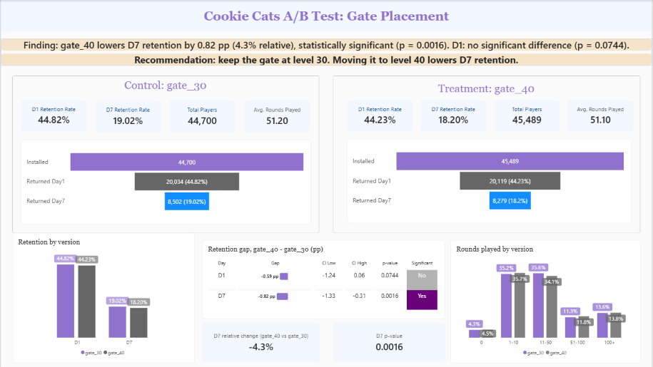

# Cookie Cats A/B Test: Gate Placement and Player Retention

Analysis of a mobile-game A/B test: does moving the first gate from level 30 to level 40 improve player retention?

**Result:** no. D7 retention is 0.82 percentage points lower with the later gate (4.3% relative, p = 0.0016), and D1 shows no significant difference. Recommendation: keep the gate at level 30.


* **Interactive Report:** [Power BI (.pbix)](powerbi/cookie_cats_dashboard.pbix)

## Business question

In Cookie Cats, players hit gates that make them wait or pay to continue. The first gate sat at level 30. Would a gate at level 40 keep players around longer? Retention is the key engagement metric, so the test compares **D1 retention** and **D7 retention** between the two versions.

## Data

90,189 players who installed the game during the test, randomly assigned to `gate_30` (control) or `gate_40` (treatment). Source: Cookie Cats A/B test dataset (Tactile Entertainment), available on Kaggle.

| Column | Meaning |
|---|---|
| `userid` | Unique player ID |
| `version` | A/B group |
| `sum_gamerounds` | Rounds played in the first 14 days after install |
| `retention_1`, `retention_7` | Player returned 1 / 7 days after install |

## Approach

1. **Data quality:** missing values, duplicate IDs, sample ratio check, outliers.
2. **Outliers:** players with extreme round counts are capped, not removed. Retention is unaffected by capping, while deleting these players would bias retention downwards because they are almost all returning players.
3. **Tests:** two-proportion z-test on D1 and D7, 95% confidence interval of the gap, relative change, Bonferroni check for two metrics.
4. **SQL layer:** the same numbers are produced with SQL queries on a SQLite database and reconciled with pandas.
5. **Dashboard:** Power BI report built from the exported CSVs, with the findings text generated by DAX measures.

## Key findings

| Metric | gate_30 | gate_40 | Gap (pp) | 95% CI (pp) | p-value |
|---|---|---|---|---|---|
| D1 retention | 44.82% | 44.23% | -0.59 | -1.24 to +0.06 | 0.0744 |
| D7 retention | 19.02% | 18.20% | -0.82 | -1.33 to -0.31 | 0.0016 |

- The D7 gap is a 4.3% relative drop and stays significant after a Bonferroni adjustment (threshold 0.025).
- D1 is measured before most players reach level 30, so it is a weak test of a gate placement change. A plausible reason the effect shows up by D7 is that more players have met the gate by then. This is a hypothesis, not tested here.
- Gate placement should be judged on D7 or later retention rather than on day 1.

## Data quality and limitations

- **Possible sample ratio mismatch:** 44,700 vs 45,489 players (49.6% / 50.4%), chi-square p = 0.0086. In a live experiment, assignment logging would be the first thing to check.
- **No pre-install variables** (platform, country, install date), so retention is not segmented. Splitting by `sum_gamerounds` would be circular: it is measured after install and is tied to retention itself.
- **Only retention is measured.** Revenue, in-app purchases and retention beyond day 7 are not available, and a gate also affects monetisation.

## Repository structure

```
cookie-cats-ab-test/
├── README.md
├── data/
│   ├── cookie_cats.csv          # raw data (download from Kaggle)
│   ├── cookie_cats.db           # generated by notebook 01
│   └── exports/                 # generated CSVs used by Power BI
├── notebooks/
│   ├── 01_ab_test_analysis.ipynb
│   └── 02_sql_queries.ipynb
├── sql/
│   ├── player_journey.sql
│   ├── kpi_summary.sql
│   └── round_distribution.sql
└── powerbi/
    ├── cookie_cats_ab_test.pbix
    ├── dashboard_spec.md
    ├── cookie_cats_theme.json
    └── dashboard.png
```

## How to reproduce

1. Place `cookie_cats.csv` in `data/`.
2. Run `notebooks/01_ab_test_analysis.ipynb` (builds the database, runs the tests, exports `test_results.csv`).
3. Run `notebooks/02_sql_queries.ipynb` (runs the SQL files, exports the remaining CSVs).
4. Open `powerbi/cookie_cats_ab_test.pbix` and refresh the data. See `powerbi/dashboard_spec.md` for the data model and DAX measures.

Requirements: Python 3, pandas, numpy, scipy, statsmodels, matplotlib, Jupyter.

## Tools

Python, SQL (SQLite), Power BI (DAX, Power Query).
